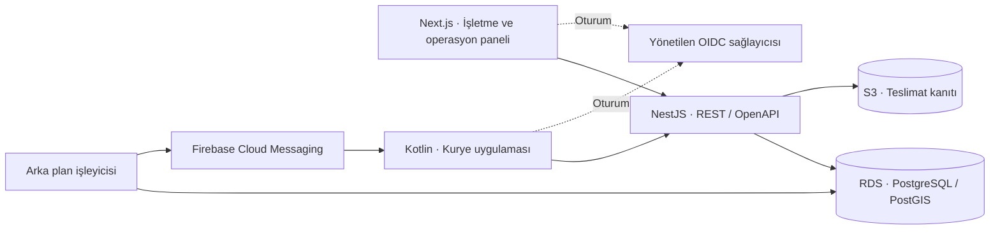

# Kuryem_Paket — Önerilen pilot mimarisi

Bu tasarım, çok kiracılı bir teslimat operasyonunda sipariş alma, kurye atama ve teslimatı tamamlama akışını kapsar. Varsayım, pilot filonun ağırlıklı olarak Android kullanmasıdır. iOS cihaz kullanımı pilot öncesi teyit edilir.

## Sistem görünümü

İşletme ve operasyon ekranları rol bazlı tek bir Next.js uygulamasında çalışır. API, NestJS modüllerini tek bir dağıtımda barındırır. Docker imajları GitHub Actions ile test edilip ECR üzerinden ECS Fargate’e dağıtılır. Arka plan işleyicisi, güvenilir bildirim veya dış entegrasyon devreye girdiğinde aynı kod tabanından ayrı bir süreç olarak çalıştırılır.

## Backend modülleri

| Modül | Sorumluluk |
|---|---|
| Tenant ve erişim | Kiracı, işletme ve şube üyelikleri, roller, sunucu tarafı yetki kontrolleri |
| Sipariş | Manuel veya entegrasyonla sipariş girişi, müşteri ve adres bilgileri, dış sipariş referansı |
| Teslimat ve atama | Teslimat durumları, manuel atama, yeniden atama, teslimat kanıtı |
| Kurye ve vardiya | Kurye profili, vardiya, müsaitlik ve kapasite |
| Konum | Konum alımı, son bilinen konum, konum geçmişi ve hizmet bölgeleri |
| Bildirim ve entegrasyon | Push bildirimleri, dış platform adaptörleri ve yeniden deneme |
| Tahsilat | Pilot nakit çalışıyorsa teslimat bazında tahsilat ve vardiya sonu mutabakatı |

Her modül kendi yazma kurallarını ve tablolarını yönetir. Teslimat ve atama gibi birlikte tutarlı kalması gereken işlemler aynı PostgreSQL işlemi içinde tamamlanır.

## Siparişten teslimata

1. İşletme veya entegrasyon siparişi oluşturur. Entegrasyon siparişleri kiracı, sağlayıcı ve dış sipariş kimliğiyle tekilleştirilir.
2. Teslimat kaydı atama bekleyen iş olarak operasyon ekranına düşer. Operatör vardiya, hizmet bölgesi ve kapasite bilgisine bakarak kurye atar.
3. Kurye işi kabul eder, paketi alır ve teslimatı tamamlar. Uygulama güncel işi API’den alır. Push bildirimi kuryeye haber verir.
4. Yeniden atamada önceki atama kapanır ve geçmişi saklanır. PostgreSQL’de kısmi benzersiz indeks bir teslimata en fazla bir aktif atama yapılmasını sağlar. Atama değişikliği ve durum kontrolü aynı işlem içinde yürütülür.
5. Teslimatın durum geçişleri ve işlemi yapan kişi kaydedilir. İptal gibi çakışan işlemlerde API güncel durumu döndürür. Kurye bağlantı geldiğinde eski atamaya ait bir işlem gönderirse API atama kimliğini ve geçişin geçerliliğini kontrol eder.

Bildirim ve entegrasyon için, ilgili veri değişikliğiyle birlikte PostgreSQL’de bir outbox kaydı yazılır. İşleyici başarısız gönderimleri yeniden dener. Tüketiciler aynı olay birden fazla kez işlendiğinde yinelenen yan etkileri engelleyecek şekilde tasarlanır.

## Native kurye uygulaması

- **Android** için Kotlin, Jetpack Compose ve Room. Kurye vardiyayı uygulamadan başlatır. Konum takibi, cihaz izinleri ve Android sürümünün kuralları doğrultusunda görünür bildirimli konum servisiyle yürütülür.
- **iOS gerekiyorsa** Swift, SwiftUI ve Core Location. Ekran kilitliyken izleme davranışı, konum izinleri ve pil tüketimi gerçek cihazlarda doğrulanır.
- **Çevrimdışı kullanım.** Teslimat komutları cihazda kalıcı olarak saklanır ve bağlantı gelince kayıt sırasıyla gönderilir. Her komutun sabit bir idempotency anahtarı vardır. Sunucu onayı alınana kadar uygulama işlemi beklemede gösterir. Yeniden atama veya iptal nedeniyle reddedilen komut kuryeye görünür.
- **Konum.** Noktalar cihazda zaman damgasıyla kaydedilir ve bağlantı durumuna göre toplu gönderilebilir. Gecikmiş noktalar geçmişe eklenebilir. Son bilinen konum yalnızca daha yeni bir kayıtla güncellenir. Harita konumun yaşını gösterir. Takip vardiya bitiminde durur.

## Veri ve erişim

- PostgreSQL sipariş, atama ve teslimat durumlarının ana kaynağıdır. PostGIS hizmet alanı ve yakın kurye sorgularını destekler. Son bilinen konum ile konum geçmişi ayrı tablolarda tutulur. Konum geçmişi için saklama süresi pilot öncesi belirlenir.
- Kimlik sağlayıcısı oturum ve MFA’yı yönetir. API, kullanıcının kiracı ve şube üyeliğini doğrular. Sipariş, konum ve atama sorguları yetkili kiracı ve şube kapsamıyla çalışır. Otomatik kontroller kiracılar arası erişimi ve şubeler arası atama yetkisini kapsar.
- Teslimat kanıtları gerekiyorsa kapalı S3 kovasında tutulur. API erişim yetkisini doğruladıktan sonra kısa süreli imzalı bağlantı verir. Konum ve müşteri adresi uygulama günlüklerine yazılmaz.

## Kritik işlem kuralları

### Eşzamanlı atama ve durum geçişleri

Teslimatın normal akışı `ATAMA_BEKLIYOR → ATANDI → KABUL_EDILDI → PAKET_ALINDI → TESLIM_EDILDI` şeklindedir. Paket alınana kadar atama geri çekilebilir veya teslimat iptal edilebilir. Paket alındıktan sonra iptal talebi iade veya yetkili devir sürecini açar. İadeyi tamamlayan kişi, zaman ve gerekçe kaydedilir.

Atama, yeniden atama, iptal ve kurye durum komutları teslimat satırını kilitler. Mobil komut aktif atama kimliğini, operasyon komutu ekranda görülen teslimat sürümünü taşır. Atama sırasında ilgili kurye kapasite satırları sabit sırada kilitlenir ve müsaitlik işlem içinde yeniden kontrol edilir. Böylece iki farklı teslimat aynı son kapasiteyi kullanamaz. Yeni atama, eski atamanın kapanışı, durum geçmişi ve ilgili outbox kaydı birlikte kaydedilir. Geçersiz veya eski durum için API `409` ve kullanıcının görmeye yetkili olduğu güncel durumu döndürür.

API, yetkiyi doğruladıktan sonra komut kimliğini kiracı ve aktör kapsamında tekilleştirir. Başarılı komutun sonucu iş değişikliğiyle aynı işlemde saklanır. Yanıt yolda kaybolursa aynı kimlik ve içerikle gelen istek önceki sonucu alır. Aynı kimlikle farklı içerik gönderilirse istek reddedilir. Tekilleştirme kayıtlarının saklama süresi cihazın desteklenen çevrimdışı tekrar süresini kapsar.

### Çevrimdışı teslimat ve konum kesintisi

Mobil uygulama komutu ve varsa kanıt dosyasının yerel referansını kullanıcıya başarı göstergesi vermeden önce kalıcı olarak yazar. Komutlar teslimat başına sırayla gönderilir. Eski atama nedeniyle reddedilen bir komut sonraki bağımlı işlemleri durdurur ve operatör incelemesine konu olur. Geçici ağ hataları gecikmeli tekrar denenir. Sunucuda kanıt zorunluysa yükleme doğrulanana kadar teslimat uygulamada senkronizasyon bekliyor görünür.

Konum alımı, teslimat komutlarından ayrı bir uç nokta ve sınırlı kaynak bütçesi kullanır. Konum paketleri vardiya ve nokta kimliğiyle tekilleştirilir. Cihaz zamanı tolerans dışındaysa nokta canlı konumu ilerletmez. Harita son güncelleme zamanını ve konumun eskidiğini gösterir. Eski konum otomatik kurye önerisinde kullanılmaz. Operatör manuel atama ve durum yönetimine devam edebilir. Cihazda konum kuyruğu sınırlıdır ve bağlantı geri geldiğinde teslimat komutları öncelikli gönderilir.

### Dış sistemler ve tahsilat

Outbox işleyicisi kayıtları süreli olarak üstlenir ve artan gecikmeyle yeniden dener. İşleyici kapanırsa süresi dolan kayıt yeniden alınabilir. Dış sağlayıcı destekliyorsa aynı olay kimliği gönderim anahtarı olarak kullanılır. Sağlayıcı işlemi uygulamış olabilir ve sonuç belirsizse, tekrar göndermeden önce sağlayıcı kaydı sorgulanır veya operatör incelemesi açılır. Kalıcı hatalar panelde gerekçeleriyle görünür. FCM kesintisinde kurye uygulaması açıkken atamaları API’den yeniler, operatör de kabul edilmeyen atamaları ekranda görür.

Nakit tahsilat pilot kapsamındaysa onaylı tutar para birimiyle birlikte en küçük para birimi cinsinden saklanır. Teslimat başına bir tahsilat kaydı oluşturulur ve tekrar gönderim ikinci kayıt üretmez. Vardiya kapanışında sistemdeki tutar ile teslim alınan nakit karşılaştırılır. Farklar yetkili onayı ve gerekçeli düzeltme kaydıyla kapatılır.

## Yayına hazırlık ve kurtarma

AWS’de Next.js ve API ECS Fargate üzerinde, PostgreSQL ise özel ağdaki RDS üzerinde çalışır. Canlı ortamda API görevleri iki erişilebilirlik bölgesine yayılır ve RDS Multi-AZ kullanılır. Otomatik yedekler belirli bir zamana geri dönüşü destekler. Kurtarma tatbikatında ayrı bir ortama geri yükleme yapılır, sipariş ve tahsilat kayıtları kontrol edilir, outbox gönderimleri dış sağlayıcı kayıtlarıyla karşılaştırıldıktan sonra yeniden başlatılır. Veri kaybı ve hizmete dönüş hedefleri pilot sahibiyle belirlenir ve tatbikatta ölçülür.

Veritabanı şema değişiklikleri eski ve yeni API sürümlerinin birlikte çalışabileceği adımlara bölünür. Sorunlu dağıtımda önceki uygulama sürümüne dönülebilir. API hata oranı, p95 gecikme, en eski bekleyen outbox kaydı ve eski konumla görünen kurye oranı için uyarı kurulur. Her uyarının sorumlusu ve ilk müdahale adımı belirlenir.

| Yayın öncesi senaryo | Beklenen sonuç |
|---|---|
| İki operatör aynı teslimata kurye atar | Tek aktif atama kalır. İkinci operatör güncel durumu görür. |
| İki teslimat aynı kuryenin son kapasitesini ister | Kapasite aşılmaz ve atama sonuçları panelde görünür. |
| Teslimat kaydedilirken API yanıtı kaybolur | Tekrar denemede önceki sonuç alınır. Teslimat ve varsa tahsilat kaydı tek kalır. |
| Kurye çevrimdışıyken atama değişir | Eski komut güncel teslimatı değiştiremez. Kurye ve operatör çözülmesi gereken kaydı görür. |
| Ekran kilitlenir ve cihaz bağlantısı kesilir | Harita konumun eskidiğini gösterir. Yeni bağlantıda komutlar senkronize olur ve eski noktalar son konumu geriye götürmez. |
| Sağlayıcı veya işleyici kesilir | Bekleyen işler görünür ve kurtarma sonrası güvenle sürdürülür. |
| Kullanıcı başka kiracının kaydını veya kanıtını ister | API kayda ve imzalı dosya bağlantısına erişim vermez. |
| Veritabanı erişilemez veya geri yüklenir | Uygulama işlemleri onay bekliyor gösterir. Kurtarılan kayıtlar ve dış etkiler kontrol edilir, dönüş süresi ölçülür. |

## Pilot ve ölçekleme kararları

| Aşama | Doğrulanacak sonuç |
|---|---|
| Cihaz denemesi | Ekran kilitliyken konum güncelliği, vardiya boyunca pil tüketimi, zayıf bağlantıda komutların ve konumların senkronizasyonu |
| Gerçek vardiya | Siparişten teslimata tamamlanan akış, atamaya kadar geçen süre, zamanında teslimat oranı ve sipariş başına manuel müdahale |
| İlk entegrasyon | Pilot müşterinin gerçek sipariş kanalı, tekrar gelen siparişlerin tekilleştirilmesi ve başarısız işlemlerin görünürlüğü |
| Atama önerisi | Vardiya, bölge, konum güncelliği ve kapasiteyle uygun kuryeleri filtreleme. Sonuçları operatör seçimiyle karşılaştırdıktan sonra otomasyonu değerlendirme. |

Konum yükü, eşzamanlı kurye sayısı ve cihaz başına gönderim aralığıyla modellenir. Örneğin 10.000 eşzamanlı kurye 10 saniyede bir nokta üretirse saniyede yaklaşık 1.000 konum kaydı oluşur. Yük testinde sipariş API’sinin p95 gecikmesi, konumun haritaya ulaşma süresi ve izleyici sayısı birlikte ölçülür.

Pilot haritası düzenli aralıklarla güncel konumu sorgular. Daha düşük gecikme veya çok sayıda izleyici gerektiğinde WebSocket değerlendirilir. Konum trafiği işlem API’sini etkilerse önce konum alımı bağımsız ölçeklenir, çalışma zamanı seçimi yük testiyle yapılır. Arka plan işlerinin bağımsız ölçeklenmesi gerektiğinde SQS, birden fazla ekibin olay geçmişini yeniden işlemesi gerektiğinde Kafka değerlendirilir. Raporlar işlem veritabanına belirgin yük bindirdiğinde ayrı analitik depo gündeme alınır.
